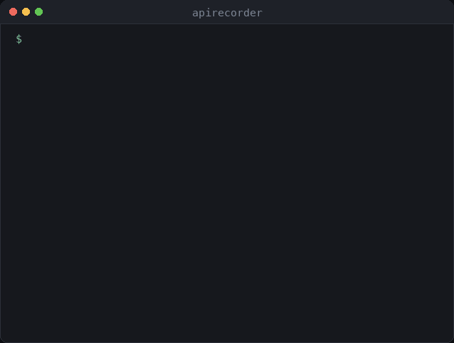
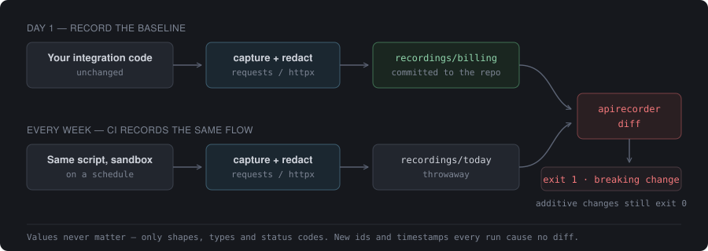
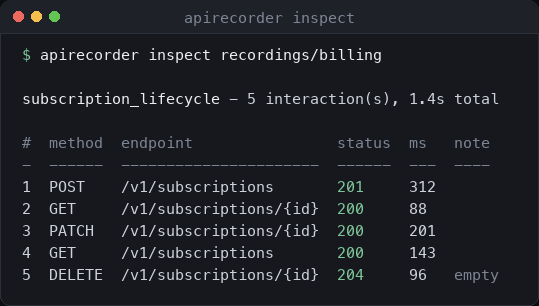
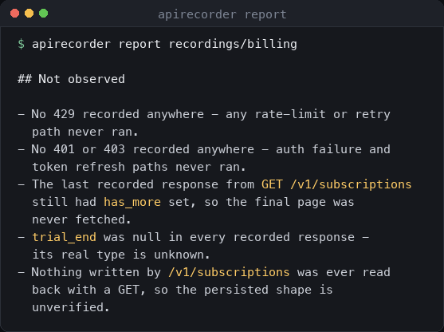

# apirecorder

**Record what a third-party API actually does, then diff it over time.**

Wrap your existing integration code in a capture block. You get a redacted JSON
recording of the real traffic, a behaviour report you can commit next to the
code, and a `diff` that fails CI when the vendor changes something your code
relies on.



That is a real run against the demo in this repo. The vendor made creation
asynchronous and renamed the pagination field — so one integration would start
throwing `KeyError`, and another would silently stop after the first page.
Both caught before deploy, by a job with no assertions written for them.

---

## Why not just write unit tests?

You should — for the handful of fields and status codes your code genuinely
depends on. `assert resp["id"]` is a statement of contract and gives a precise
failure. For a four-endpoint integration, write the four tests and skip this.

The problem is that **a test only checks what you thought to check.**

Nobody writes `assert resp.status_code == 201` on a create they expect to
succeed; they write `raise_for_status()`, which passes happily on a 202. Nobody
asserts that `has_more` exists, because `while resp["has_more"]` just worked —
until it was renamed and the loop started exiting after one page, with every
test still green.

`apirecorder` compares the *whole* observed shape, including the fields your
code doesn't read yet and the ones you never knew were there. It classifies what
it finds, so additive vendor changes don't fail CI and get `--update`'d
reflexively.

It is snapshot testing, specialised for HTTP. The HTTP-specific parts are what
make it worth more than a generic snapshot library here:

- redaction **before** anything is written to disk, not scrubbed afterwards
- path templating, so `/subs/sub_9f21` and `/subs/sub_3b02` are one operation
- breaking vs additive vs info classification
- coverage gaps: the paths your recordings never exercised at all

**Use both.** Assert the ten things you depend on; diff everything else.

---

## How it works



---

## Install

> **Not on PyPI yet.** `pip install apirecorder` will not work. Install from
> GitHub:

```bash
pip install "git+https://github.com/varun1414/api-recorder.git"
```

Or pin it as a dev dependency — it is a development tool and should not ship to
production:

```toml
[project.optional-dependencies]
dev = ["apirecorder @ git+https://github.com/varun1414/api-recorder.git"]
```

There are no required runtime dependencies. `apirecorder` patches whichever HTTP
client you already use, and everything else is standard library. Supports
Python 3.8+, `requests` 2.20+ and `httpx` 0.23+ (sync and async).

### From source

```bash
git clone https://github.com/varun1414/api-recorder.git
```

```bash
cd api-recorder && pip install -e ".[dev]"
```

---

## Try it in ten seconds, with no API

The repo ships a self-contained demo: it starts a fake billing API on loopback,
records a baseline, restarts it as a drifted version, and prints all three
outputs. No network access and no credentials needed.

```bash
python examples/demo.py
```

---

## Quickstart

### 1. Record

The only change to your code is the `with` block. Everything inside it is
untouched — responses reach your code as they always did, and exceptions
propagate normally. The recorder only observes.

```python
import requests
from apirecorder import Recorder

rec = Recorder(output="recordings/billing", redact=["Authorization"])

with rec.capture("subscription_lifecycle"):
    s = requests.Session()
    s.headers["Authorization"] = f"Bearer {TOKEN}"

    sub = s.post("https://api.billing.com/v1/subscriptions",
                 json={"customer": "cus_42", "plan": "pro"}).json()

    s.get(f"https://api.billing.com/v1/subscriptions/{sub['id']}")
    s.patch(f"https://api.billing.com/v1/subscriptions/{sub['id']}",
            json={"plan": "enterprise"})
    s.get("https://api.billing.com/v1/subscriptions?limit=2")
    s.delete(f"https://api.billing.com/v1/subscriptions/{sub['id']}")

rec.save()
```

This writes `recordings/billing/subscription_lifecycle.json`:

```json
{
  "seq": 1,
  "request": {
    "method": "POST",
    "url": "https://api.billing.com/v1/subscriptions",
    "path": "/v1/subscriptions",
    "query": {},
    "headers": {"content-type": "application/json", "authorization": "[REDACTED]"},
    "body": {"kind": "json", "value": {"customer": "cus_42", "plan": "pro"}}
  },
  "response": {
    "status": 201,
    "headers": {"content-type": "application/json", "x-api-version": "2026-04-01"},
    "body": {
      "kind": "json",
      "value": {
        "id": "sub_9f21", "customer": "cus_42", "plan": "pro",
        "status": "active", "trial_end": null, "current_period_end": 1763251200
      }
    }
  },
  "duration_ms": 312
}
```

The bearer token is `[REDACTED]` because it was never written, not because it
was cleaned up afterwards.

### 2. Look at what you captured

```bash
apirecorder inspect recordings/billing
```



### 3. Write down what the API did

```bash
apirecorder report recordings/billing -o docs/billing-behaviour.md
```

The report has two sections that are kept strictly apart.

**Observed** — per operation: status codes seen, every response field with its
type, whether it was ever null, whether it was sometimes missing, latency, the
stable response headers, and the call sequence.

**Not observed** — gaps in the recording:



Those are the lines you cannot get by reading your own code.

### 4. Diff, forever after

```bash
apirecorder diff recordings/billing recordings/billing-ci
```

`diff` exits **1** when something breaking appears, **0** otherwise — so it drops
straight into CI.

---

## Using it in a real project

### Step 1 — write one recording script

This is the main thing to get right. It lives in `scripts/`, **not** in your test
suite — your tests shouldn't hit the network, and this deliberately does.

```python
# scripts/record_billing_flow.py
import argparse, os, requests
from apirecorder import Recorder

BASE = os.environ["BILLING_SANDBOX_URL"]

def one_pass(s):
    """Create, read, update, list, delete. Self-cleaning on purpose."""
    sub = s.post(f"{BASE}/v1/subscriptions",
                 json={"customer": "cus_test", "plan": "pro"}).json()
    s.get(f"{BASE}/v1/subscriptions/{sub['id']}")
    s.patch(f"{BASE}/v1/subscriptions/{sub['id']}", json={"plan": "enterprise"})
    s.get(f"{BASE}/v1/subscriptions", params={"limit": "2"})
    s.delete(f"{BASE}/v1/subscriptions/{sub['id']}")

def main():
    p = argparse.ArgumentParser()
    p.add_argument("--out", default="recordings/billing")
    p.add_argument("--iterations", type=int, default=5)
    a = p.parse_args()

    rec = Recorder(output=a.out, redact=["Authorization"])
    s = requests.Session()
    s.headers["Authorization"] = f"Bearer {os.environ['BILLING_TOKEN']}"

    with rec.capture("subscription_lifecycle"):
        for _ in range(a.iterations):
            one_pass(s)
    rec.save()

if __name__ == "__main__":
    main()
```

Three things in there matter:

**It deletes what it creates.** Otherwise every CI run leaves junk in the sandbox
and you will be rate-limited or locked out of it within a month.

**`--iterations 5`, not 1.** This is the single most important tip in this
README. With one pass, a field the API *sometimes* omits looks always-present in
the baseline — and the next run reports its absence as a **breaking** removal.
With five passes the baseline records it honestly as "3 of 5", and a later
absence is only `info`. Multiple iterations are how you stop false alarms.

**Sandbox, never production.** It does real writes.

### Step 2 — first run, then actually read the output

```bash
python scripts/record_billing_flow.py --out recordings/billing
```

Before you commit anything, check the recordings yourself. Redaction catches
known names; it cannot know your vendor puts a signed URL in a response body.

```bash
grep -rIE 'sk_|Bearer |eyJ|secret|password' recordings/billing | head
```

If something slipped through, add it to `redact=[...]` and re-record. Don't
scrub the file by hand — the point is that the recorder never writes it.

### Step 3 — commit the baseline and the report

```bash
apirecorder report recordings/billing -o docs/billing-behaviour.md
```

Commit both `recordings/billing/` and `docs/billing-behaviour.md`. The report is
what your teammates read; the recordings are what CI diffs against.

Read the **Not observed** section once, properly. That is your list of untested
paths, and the only output that tells you something you could not have worked
out from your own code.

### Step 4 — the CI job

Weekly suits most vendors. Daily is noise; monthly is too late.

```yaml
name: api-drift
on:
  schedule:
    - cron: "0 6 * * 1"
  workflow_dispatch:

jobs:
  drift:
    runs-on: ubuntu-latest
    steps:
      - uses: actions/checkout@v4
      - uses: actions/setup-python@v5
        with:
          python-version: "3.12"

      - run: pip install -e ".[dev]"

      - name: Record today's run against the vendor sandbox
        env:
          BILLING_TOKEN: ${{ secrets.BILLING_SANDBOX_TOKEN }}
          BILLING_SANDBOX_URL: ${{ secrets.BILLING_SANDBOX_URL }}
        run: python scripts/record_billing_flow.py --out /tmp/billing-ci

      - name: Diff against the committed baseline
        run: apirecorder diff recordings/billing /tmp/billing-ci

      - name: Publish the drift report
        if: failure()
        run: |
          apirecorder diff recordings/billing /tmp/billing-ci \
            --format markdown -o drift.md || true

      - uses: actions/upload-artifact@v4
        if: failure()
        with:
          name: drift-report
          path: drift.md
```

Note `/tmp` for the CI recording — you never want the fresh run committed by
accident.

### Step 5 — the habit, when it goes red

1. **Read the diff.** Breaking lines only; ignore info on the first pass.
2. **Decide which it is:**
   - *The vendor changed something you depend on* → fix the integration, then
     re-record the baseline in the same PR.
   - *The vendor changed something you don't depend on* → re-record the
     baseline. One-line PR, deliberately.
   - *Your recording script changed* → that shows as `info` coverage, not
     `breaking`. If it is breaking, your script is doing something genuinely
     different.
3. **Never** update the baseline and fix the code in two PRs where the baseline
   update lands first. That is how you lose the signal.

Baseline updates should be their own small PR with the diff output pasted into
the description. If someone can refresh a baseline without reading it, the whole
thing becomes decoration.

### What will *not* give you false positives

**Only shapes and types are compared, never values.** New ids every run,
changing timestamps, different amounts, varying `request-id` headers — none of
it registers. Paths are templated, so `/subs/sub_9f21` and `/subs/sub_3b02` are
the same operation. Latency is only reported when the p50 at least doubles *and*
moves 200ms.

---

## How changes are classified

| Severity | Meaning | Fails CI |
|---|---|---|
| `breaking` | Something your code could already rely on changed: a primary status code, a field that was always present, a type, a field that became nullable or optional | yes |
| `additive` | The API gained a field or an endpoint. Safe for existing code | only with `--strict` |
| `info` | Worth a glance, not a contract change: a new status code seen for the first time, a stable response header whose value moved, a big latency shift, or an operation one side didn't exercise | no |

Two decisions worth knowing about:

**Coverage differences are not breaking.** If the baseline recorded
`GET /subscriptions` and this run didn't, that usually means your script
changed, not the API. Calling it breaking would train people to ignore the
output.

**A status change doesn't hide the body change underneath it.** When a create
goes `201 -> 202`, the old and new bodies share no status group, so the fields
are compared across the pairing and reported as `POST /subs 201->202`. The
dropped field is the part that actually breaks callers.

---

## CLI reference

```bash
apirecorder inspect RECORDINGS
```

```bash
apirecorder report RECORDINGS [-o OUT.md] [--title TITLE]
```

```bash
apirecorder diff BASELINE CURRENT [-o OUT] [--format text|markdown] [--strict] [--no-info]
```

`RECORDINGS` is a capture file or a directory of them. Non-capture JSON in a
directory is skipped.

| Flag | Effect |
|---|---|
| `--strict` | Exit 1 on additive-only changes too |
| `--no-info` | Hide info-level lines from text output |
| `--format markdown` | Render the diff as Markdown, for a PR comment |

Exit codes: `0` nothing breaking, `1` breaking change found, `2` bad usage.

---

## Redaction

Redaction runs while the interaction is still in memory. Nothing unredacted is
ever written.

Always redacted, whether you ask or not:

- **Headers**: `authorization`, `proxy-authorization`, `cookie`, `set-cookie`,
  `x-api-key`, `api-key`, `x-auth-token`, `x-csrf-token`
- **Body and query fields**: `password`, `secret`, `client_secret`,
  `access_token`, `refresh_token`, `id_token`, `api_key`, `private_key`,
  `session_token`

Add your own:

```python
Recorder(redact=["X-Tenant-Secret", "ssn"])
```

Names are matched after lowercasing and stripping `-`/`_`, so one entry covers
`X-Tenant-Secret`, `x_tenant_secret` and `xTenantSecret`. Matching is on the
whole name, so redacting `token` does not blank out `tokenizer_version`.

Redaction reaches nested objects and arrays, form-encoded bodies (so a
`password=` in a login POST is caught), query parameters, and the stored URL.

**Still check your recordings before committing them.** A secret in an
unexpected place — a signed URL in a response body, PII in a payload — is not
something a name-based rule can find for you.

---

## What gets recorded

| Thing | Behaviour |
|---|---|
| JSON bodies | Parsed and stored |
| Form-encoded bodies | Parsed into a mapping, so fields can be redacted |
| Text bodies | Stored as text |
| Binary bodies | Content type and size only |
| Streamed bodies | Not stored — reading them would break your code |
| Bodies over 256 KiB | Content type and size only |
| Redirects | One record per hop |
| Transport failures | Recorded with the exception type, then re-raised |

Only JSON and form bodies take part in analysis and diffing. A recording never
implies it knows more than it saw.

---

## Limitations

Worth knowing before you rely on it.

### GraphQL and single-endpoint APIs are not usefully supported

Operations are keyed on `(method, templated path)`, and every GraphQL call is
`POST /graphql`. So every query and mutation collapses into **one** operation and
the field inventory becomes the union of every response shape you ever got,
which makes the diff close to meaningless. The same applies, less severely, to
any API that tunnels operations through a single endpoint (some SOAP and
JSON-RPC services).

Grouping by the operation name in the request body would fix this. It is not
implemented. Until it is, don't point this at a GraphQL endpoint.

### Everything else

- **SDK-level capture only.** The hooks patch `requests` and `httpx`. An
  integration using `aiohttp`, `urllib3` directly, or a vendor SDK with its own
  transport is not captured — `boto3`/`botocore` (urllib3) and
  `google-api-python-client` (httplib2) are common examples. To check your own
  SDK, wrap one call and see whether anything landed:

  ```python
  with rec.capture("probe"):
      my_sdk.do_one_thing()
  print(len(rec.interactions()))  # 0 means the SDK bypasses both hooks
  ```

- **XML and SOAP get no field analysis.** Those bodies are stored as text, so
  `inspect`, status codes, latency and headers still work, but there is no
  field inventory and no field-level diff. Inferring a schema from a string
  would be guesswork.
- **Patching is global and process-wide.** A capture block records traffic from
  every thread, and two `Recorder`s cannot capture at once (it raises rather
  than silently interleaving). Nested blocks are rejected.
- **Path templating is a heuristic.** A segment is treated as an id if it looks
  like one — a UUID, all digits, long hex, a prefixed id like `sub_9f21`, or a
  long opaque string containing a digit. Ordinary words are left alone, so
  `/users/me` stays `/users/me`. It errs towards under-templating, because
  merging two genuinely different operations is the worse failure.
- **A diff is only as good as the flow you record.** It compares what both runs
  exercised. An endpoint your script never calls cannot drift in the report.
- **No replay or mock server yet.** This records and compares; it does not serve
  recorded responses back.

---

## Development

```bash
python -m venv .venv && .venv/bin/pip install -e ".[dev]"
```

```bash
.venv/bin/python -m pytest
```

The capture tests run against a real loopback HTTP server rather than a mocked
transport — patching a client and asserting against a mock would only test the
mock, not whether the patch points sit where the traffic actually is.

The README's terminal media is generated, not hand-made. Regenerate it with:

```bash
pip install Pillow && python docs/make_media.py
```

---

## Roadmap

- **0.2** — replay: return recorded responses from the same patch points, for
  offline tests; GraphQL operation grouping
- **0.3** — OpenAPI generation from the analysis pass
- **0.4** — pytest fixture/test generation; optional proxy capture for clients
  the SDK hooks can't see

Publishing to PyPI is pending; until then, install from GitHub as above.

---

## License

MIT. See [LICENSE](LICENSE).
